<div align="center">

# 💗 soft hearts

<p align="right"><a href="#zh"></a></p>

<b>A small 3D companion who lives on your desktop. A place to catch your breath.</b><br><b>住在你桌面上的 3D 小伙伴，一个可以歇脚的地方。</b>

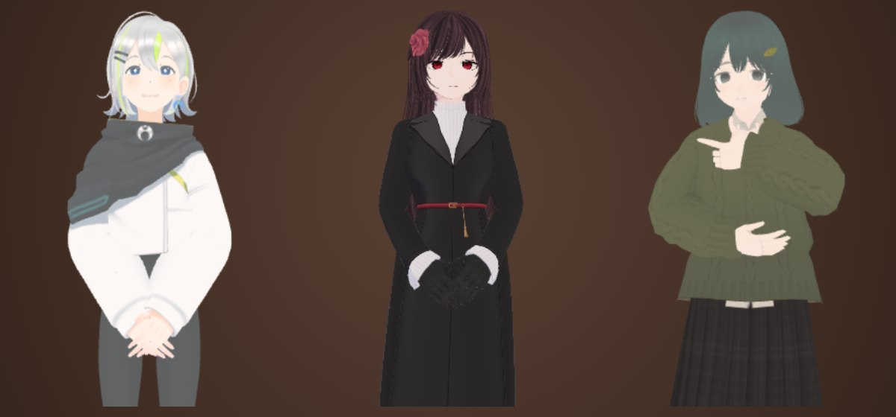

<sub>Gene: CG-CA Gene (c) 2023 by Nagoya Institute of Technology, Moonshot R&D Goal 1 Avatar Symbiotic Society, CC BY 4.0 ([notices](THIRD_PARTY_NOTICES.md)). One and Mumi: models by the soft hearts author.</sub>

<a href="#install">🚀 Install</a> · <a href="#features">✨ What she can do</a> · <a href="#first-use">👣 First use</a> · <a href="#thanks">🙏 Thanks</a> · <a href="#zh">📖 中文</a>

**▶ [Demo video (recorded on v0.1.0) · 演示视频（0.1.0 版时录的，B 站）](https://www.bilibili.com/video/BV1eEWW6DEQL/)**

</div>

> **Made for Claude and for Windows.** To connect another model or run on macOS / Linux, see [docs/PORTING.md](docs/PORTING.md) (best effort, not supported: we do not test or maintain other models or systems).
>
> **专为 Claude、专为 Windows 做。** 想接别的模型（比如 DeepSeek、ChatGPT 一类）或在 macOS / Linux 上跑：看 [docs/PORTING.md](docs/PORTING.md)（尽力而为的说明，不保证，我们不测试也不维护别的模型和系统）。

## 🌍 English

> **English:** soft hearts works in Chinese or English: the interface (it follows your system language, changeable in Settings), the read-aloud voice and the preinstalled characters (each comes as a Chinese and an English card) all have both, and your Claude Code asks which one you want when it installs her. Her words are generated from a character card and an AI model; they speak for the character, not for the model provider (Anthropic) or the developers.

Find the project on [GitHub](https://github.com/LexZeon/soft-hearts). This edition uses your own signed-in **Claude Code** for chat.

soft hearts is a lightweight 3D AI desktop companion and a Windows desktop preview. It is independently built, open source and under ongoing development. It supports PMX/PMD (MMD) and VRM models and does not use Live2D.

<table>
<tr>
<td width="50%" valign="top">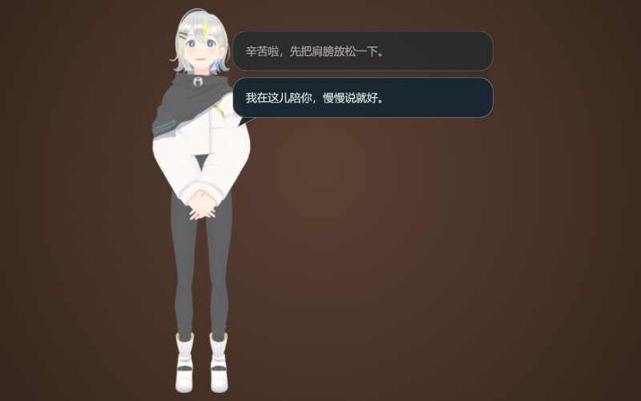<br><sub><b>🏠 Lives on your desktop</b><br>She lives on your desktop in a small transparent window, and can read her replies aloud.</sub></td>
<td width="50%" valign="top">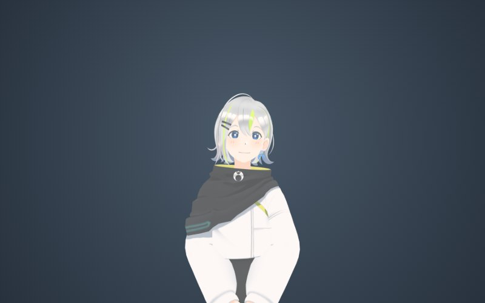<br><sub><b>🚶 Walks onto the whole screen</b><br>Full-screen mode: she steps out of the small window onto the whole screen.</sub></td>
</tr>
<tr>
<td width="50%" valign="top">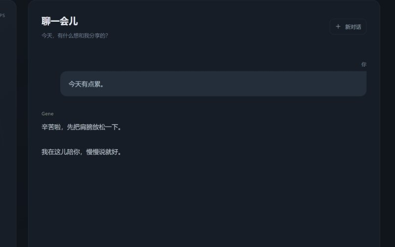<br><sub><b>💬 Chats through your own Claude</b><br>Chat goes through your own signed-in Claude Code.</sub></td>
<td width="50%" valign="top">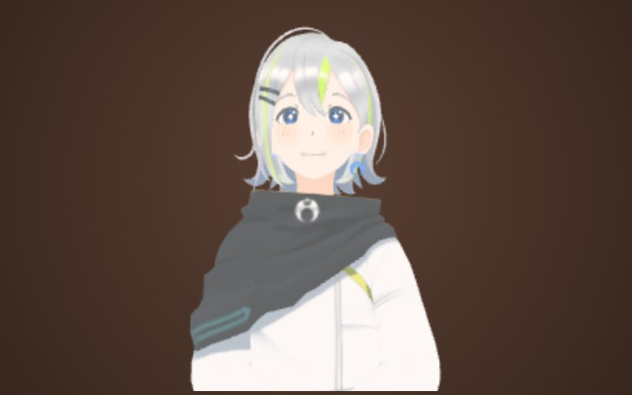<br><sub><b>🤗 A pat on the head</b><br>Pat her on the head and she answers.</sub></td>
</tr>
<tr>
<td width="50%" valign="top">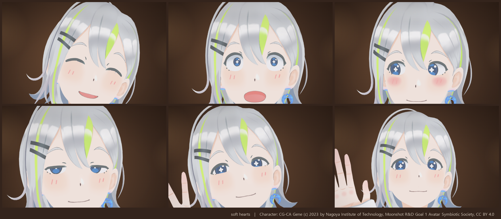<br><sub><b>🎭 Moods and expressions</b><br>Her moods and expressions change as you talk. (The picture carries its own credit line: Gene, CC BY 4.0.)</sub></td>
<td width="50%" valign="top">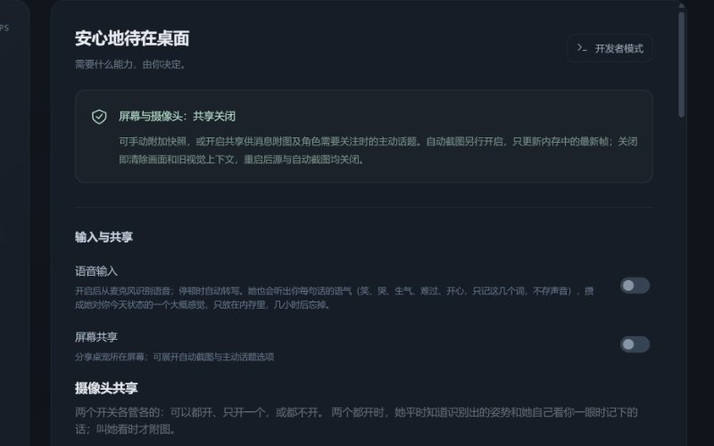<br><sub><b>🔒 Off until you say so</b><br>Voice input, screen sharing and camera sharing are all off until you turn them on.</sub></td>
</tr>
<tr>
<td width="50%" valign="top">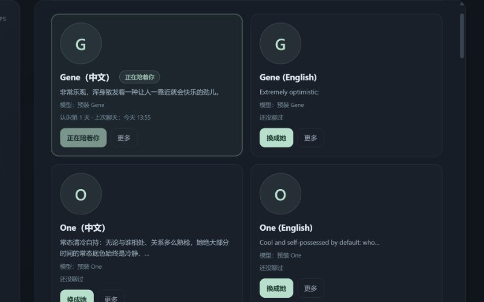<br><sub><b>💗 Character cards</b><br>Three preinstalled characters, each with a Chinese and an English card. Make your own, or bring a PMX/PMD or VRM model.</sub></td>
<td width="50%" valign="top">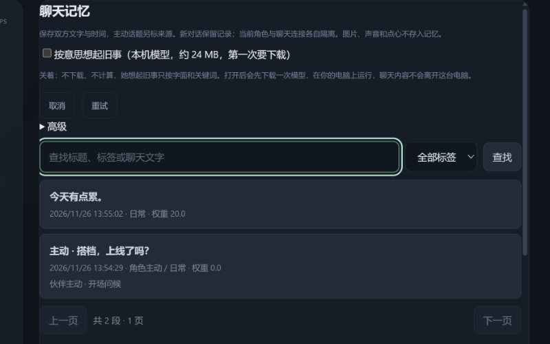<br><sub><b>📔 Memory and diary</b><br>Chat memory, her diary and your profile stay on your computer. You can view and delete them.</sub></td>
</tr>
</table>

<p align="center"><b>🎞️ In motion</b></p>
<table>
<tr>
<td width="33%" valign="top" align="center">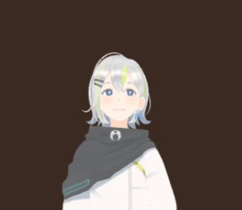<br><sub>At rest in her window</sub></td>
<td width="33%" valign="top" align="center">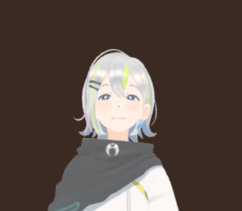<br><sub>A pat on the head: she closes her eyes</sub></td>
<td width="33%" valign="top" align="center">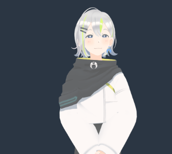<br><sub>In full screen</sub></td>
</tr>
</table>

<p align="center"><sub>Gene: CG-CA Gene (c) 2023 by Nagoya Institute of Technology, Moonshot R&D Goal 1 Avatar Symbiotic Society, CC BY 4.0 ([notices](THIRD_PARTY_NOTICES.md)). One and Mumi: models by the soft hearts author.</sub></p>


<a id="install"></a>

## 🚀 Let Claude Code install the repository

Send your Claude Code the repository URL and this request:

> Please install and launch soft hearts from https://github.com/LexZeon/soft-hearts by following the repository’s START-HERE.md step by step. Use my own Claude Code login for chat. Please introduce what she can do first. I can use the defaults for preferences and change them later.

**For Claude Code:** Read [START-HERE.md](START-HERE.md) in full and follow all seven steps. After installation and a confirmed reply, relay the creator’s message in step 5 and ask about character customization, using a personal model or expressive speech in step 6.

Claude Code checks repository access and your local environment before preparing, launching and verifying the app. You can also download the source ZIP, extract it fully to a short path such as `C:\soft-hearts`, and double-click `start-soft-hearts.cmd`. If Windows has marked files as downloaded from the internet, the launcher explains this and asks whether to unblock only the soft hearts files in that folder. Press Y to agree. You can also right-click the ZIP before extracting it, choose **Properties** and check **Unblock**. The first run installs and launches the companion from source in a few minutes. It starts with bundled Gene on a fresh profile, keeps any existing model choice, and lets you choose your own PMX/PMD model later. The source contains no private models, accounts or keys.

Use the official Claude Code on your computer with your own subscription. soft hearts never reads, stores or forwards login credentials. While the app is running, its internal channel for your Claude Code is on by default. About 20 seconds after launch it registers an MCP entry in Claude Code’s user configuration: `soft-hearts-next` for packaged stable, or `soft-hearts-next-dev` for source and development. You can then ask Claude to switch characters or change settings. Disable the channel under **Privacy & settings → Claude internal channel**. Voice input defaults to local recognition. The recognition component needs a first-time download and your voice stays on your computer. A Claude Code login does not provide transcription.

**Whose words are these?** Her replies reflect the character card and the AI model. She speaks for the character and does not represent Anthropic or the developers. The same model may answer very differently as an assistant and as this character. The character card cannot override safety limits on actions that would genuinely harm people.

<a id="features"></a>

## ✨ What the first edition includes

- 🪟 The transparent companion window and the control window can stay on top, hide or let clicks pass through. Move the pointer near the relevant areas to reveal controls, the chat input and window dimensions. Hold the move button to drag a window. In **Resize window**, drag any of the four corners to change width and height independently while keeping the character’s proportions. The outline and corners appear only in resize mode.
- 🎭 Gene, One and Mumi are preinstalled, each with separate Chinese and English cards, a model (One uses VRM and Mumi uses PMX), and a Fish Audio voice that requires your key. Gene comes with textures and 40 matching VMD motions, plus 13 credited idles, conversational gestures and short dances. Load local PMX/PMD or VRM models and VMD motions. Breathing, blinking and pointer tracking are supported.
- 🎥 In camera editing mode in the preview or companion, hold the left mouse button to turn in place as in a first-person game. Right-drag to pan, move with WASD, rise with Space and descend with Z. Hold Shift to reduce rotation, panning, keyboard movement and wheel zoom to one-quarter speed. Tab frames the current model head to toe and Esc finishes. Shortcuts work only when the camera canvas has focus. Text fields edit normally. Framing saves automatically, and numerical controls and full-body/close-up framing are available.
- 💬 Companion chat uses the signed-in local Claude Code in a persistent process with all tools disabled. Authorized task execution is available and off by default.
- 🗂️ Create, duplicate, edit and switch character cards, import or export JSON, and optionally link the current model. Chat supports streaming text, stopping a reply, rounded reply bubbles and system speech. Voice input has its own switch and can use a compatible transcription service.
- 👀 Screen and camera sharing have separate switches. The latest image is attached when you send a message. You can also attach a single snapshot manually. Both are off by default.
- 🧰 To let local Claude Code read or write files in a selected folder or run commands, enable **Claude tasks** and select a folder. Reads are automatically allowed. Every write or command requires your approval.

The eyes and head both track the pointer. Nearby movement primarily moves the eyes. The farther away the pointer is, the more the head contributes. Both ease independently and have rotation limits.

A reply bubble sits beside the character with a short triangular pointer. Three bouncing dots appear once the request is accepted and give way to the first text segment. Stopping or failing clears the indicator. With speech on, the bubble remains until playback ends, then stays for five seconds. With speech off, the timer starts when the reply completes. A new reply replaces the old one. The toolbar and input appear independently as the pointer approaches, then hide one second after it leaves. Use `>` to collapse the toolbar to a single `<`. It starts expanded on restart. Focus, dragging and editing modes keep the relevant controls visible. A hit on the scalp immediately shows 👋 and triggers a smooth response. After two seconds of the same contact the toolbar briefly fades. Touch does not reveal a hidden toolbar, and hovering still does not earn an interaction reward.

The everyday interface shows brief notices with details available on demand. Developer mode shows raw diagnostics. With a model already configured, the control window does not open on launch. Open it from the companion settings, tray or desktop shortcut. Chat voice buttons sit separately. Only one temporary toolbar panel opens at a time. Closing a panel leaves enabled audio switches on.

Late at night she gets sleepy and can fall asleep (since v0.1.1); pillows, furniture and new sleeping poses are not there yet. What each version changed, which settings carry over and what is still unverified are on the repository’s Releases page and in [docs/release-notes](docs/release-notes/).

<a id="run"></a>

## 🛠️ Run from source

<details>
<summary>▸ Show the details</summary>


You need Node.js 22.12+, the pnpm version pinned in `packageManager`, and a graphics driver with WebGL support. Set up models and model services as needed. Local speech recognition, posture sensing and similar components download only when you choose **Download**. The latest desktop launcher can optionally use the local recognizer management script that you select and restore that connection when it starts. See Voice input for details.

```powershell
pnpm install
pnpm dev
```

To run after building:

```powershell
pnpm build
pnpm start
```

`pnpm run pack` creates an unpacked desktop app. Use the full command because `pnpm pack` is pnpm’s own packaging command. `pnpm dist:win` creates a Windows portable build in `release/`. The first install downloads Electron, and the first packaging run may also download packaging tools. Builds are unsigned.

Double-click `start-soft-hearts.cmd` to install, build and launch from source with the development profile. If this folder has never had a development package, that is all the launcher does. To create a desktop shortcut, run `.\start-soft-hearts.cmd desktop` in a terminal (include `.\` in PowerShell), or `pnpm desktop:update` if pnpm is installed. Once the folder has a development build, double-clicking runs the equivalent of `pnpm desktop:update`. It snapshots the source, checks types, tests, assets and the packaged app, installs the development build and updates **soft hearts next - 最新开发版**. If the source has not changed it refreshes the shortcut without repackaging. If packaging fails, the companion keeps running as before and the window explains why in Chinese. Each folder has its own development marker and packaging cache. If you extract a new ZIP into a new folder, run `.\start-soft-hearts.cmd desktop` there again.

When you are happy with the tested development build, double-click `promote-to-stable.cmd`, run `.\promote-to-stable.cmd` in a terminal, or run `pnpm desktop:promote`. It promotes a development build already packaged in this folder. If you have only run from source, package it first with `.\start-soft-hearts.cmd desktop`. Promotion copies the tested build to stable and creates **soft hearts next - 稳定版**. Later development updates leave it alone. Use the stable shortcut for day-to-day companionship. Only stable uses the original `%APPDATA%\soft-hearts-claude` profile. Development and all source launches (`start-soft-hearts.cmd`, `pnpm dev` and `pnpm start`) use `%APPDATA%\soft-hearts-claude-dev`. On first creation, settings are copied once from stable in read-only fashion. There is no further sync or write-back. Only one instance can use a profile at a time. Quit from the tray before opening another version on the same profile. Source and development share a profile and cannot run together. If the new stable build has a problem, use `pnpm desktop:rollback` (`node scripts/update-desktop.mjs --rollback-stable`). It points stable and its shortcut back to the previous verified archived build without repackaging or changing settings. Run `promote-to-stable.cmd` again to return to the current development build. These scripts recognize only `soft hearts next.exe` and the two shortcut names above.

</details>

<a id="first-use"></a>

## 👣 First use

1. A fresh launch loads bundled Gene and Stand without a model or motion download. To use your own model, select a `.pmx`, `.pmd` or `.vrm` file, preserving the original texture folders. Fully extract any archive first. Existing model choices carry over. Choose **Use bundled Gene** to switch back.
2. Choose **Adjust camera**. The companion picks up the saved view. Hold and drag the move button to reposition the window. Select **Resize window** and drag the corners to change the size. Let go to save and choose **Done** or press Esc to exit. Character proportions stay natural and resizing preserves the current camera.
3. Chat defaults to your own Claude Code login. Once checked, send a message and confirm an actual reply. Spoken replies have their own switch.
4. Turn on screen or camera sharing from the floating toolbar when you need vision, or attach a snapshot manually. Image attachments require a model with image input. Enabled sharing sends images to the model only with a message. It does not make periodic AI requests.
5. For voice input, verify the transcription connection and decide whether to turn on the microphone. Claude Code login does not provide transcription. With voice input on, click her first to focus the companion window, **hold T to speak, then release it to transcribe and send**. T still types normally in a focused input that already contains text. Audio is discarded while T is up. During a reply, transcribed text stays in the input box.

Textures must be within the selected model’s directory or a subfolder. Relative paths that go up to the parent are outside the allowed file scope.

Click-through is your own setting. Showing or hiding her (tray menu, `Ctrl+Alt+P`, closing the window) does not change it. To turn it off, use **Restore mouse interaction** in the tray menu or the switch on the settings page. `Ctrl+Alt+P` only shows or hides her. After you close the control window the app can stay in the tray. Quit from the tray menu.

**Show companion** at the top of the control window reveals the existing window and keeps its position, size, camera and interaction settings. If she is off-screen or the camera has drifted, use **Recover companion** beside it. This centers her on the display containing the control window, restores default size, always-on-top and interaction, and frames the current model head to toe. It resets companion display settings only, preserving the model, motion, connections and character cards.

<a id="backend"></a>

### 💬 Chat backend

<details>
<summary>▸ Show the details</summary>


Chat uses your own [Claude Code](https://code.claude.com/docs/en/setup) login. Leave the model blank to use the Claude Code default, or enter `haiku`, `sonnet`, `opus` or a full model ID. This edition uses Claude only.

Chat uses one persistent `claude -p --input-format stream-json` process (renewed every 12 turns or after 10 idle minutes; `SOFT_HEARTS_CLAUDE_PERSISTENT=0` goes back to one call per reply). It runs in an empty temporary directory with all built-in tools, MCP, slash commands, skills, plugins, hooks, CLAUDE.md and settings files turned off, and it does not save sessions. At startup the tool list is checked, and if any tool is available the turn stops. When the companion is launched from a Claude Code session, the parent session’s connection information is not passed to the child process. See `electron/brain/claude.ts`.

</details>

<a id="models"></a>

### 🎵 Models, motions and voice

<details>
<summary>▸ Show the details</summary>


Manage [character cards](docs/character-cards.md) on the **Character** page. Cards store identity, background, speaking style, greetings, examples and mood templates. Choosing a character starts a new conversation and syncs the two windows. Linking a local model is optional. A v2 export contains the persona and parameters and excludes live state, private chats, models and connection keys. See the mood-card guide for how to write one. Model blush calibration is saved locally and separately.

The source ZIP and application package include Gene, 10 required textures, 40 matching motions and 13 selected motions: five 100STYLE idles, five MPI EMBM conversational gestures, two GENEA 2022 gestures and one fnoji Split Dance. First load and motion switching work offline. In **Model & motions → Bundled motions**, filter by motion type, multiple tags or English name. Choose a motion and click **Preview motion** to play it in the control window. **Stop preview** restores the previous motion. **Activate motion** saves and syncs to the companion. Click a tag below a motion to filter by it. Multiple tags must all match. Remove tags individually or clear the filter. **Use bundled Gene** restores the model and Stand while keeping chat connections, persona and other settings. First launch does not overwrite existing profiles. The project does not include Uka, private user models or local test assets.

In the motion library, **Apply to** lets you choose body pose, gesture or facial expression, and activate, clear or preview body pose, gesture and facial expression independently. For example, keep Stand and play a conversational gesture with the Happy expression. Changing the pose keeps the selected expression. Gestures override only the relevant upper-body bones. Old configurations still play the full motion. The original facial expression source carries over on first use of layers.

The music button in the floating toolbar enables movement to system audio. When turned on, the app analyzes the current system sound locally and uses beats and frequency changes to gently sway, bounce or nod. Set **Music movement strength** in appearance settings. At 0 she stays still. Spoken replies, direct interaction and manually selected head motions take priority. Movement fades when sound goes quiet. Click again to stop analysis immediately and briefly blend back into the underlying motion. Hiding the companion or quitting releases audio capture. The feature is off by default, does not record or send system audio to chat, and is currently Windows-only.

Public assets are organized by source, character and fixed version under `assets/bundled/mmdagent-ex/gene/` in `model/`, `motions/pose/`, `motions/expression/`, `motions/reaction/` and `metadata/`. Filenames are in English, and manifests keep original names, sources, SHA-256 values and tags. PMX/VMD internal names, texture references and original file contents are untouched. Gene retains CC BY 4.0, creator attribution and the full upstream notes. The code’s MIT license does not cover these assets. The character has separate trademark and design-rights notices. For other commercial uses of the character, follow the creator’s contact instructions. Other models may only partially match these motions. See [bundled assets and licensing](docs/motion-library.md).

Three.js MMD plays VMD bone and expression tracks. VMD camera and audio are excluded. Under **Model & camera → Local physics**, independently enable hair movement and chest spring, adjust each strength and choose the physics quality. Both start off and work in the companion window on models with the required structure. Gene supports hair movement and lacks the chest structure this module needs. Turning physics off or hiding the companion releases the local physics objects without altering the model or motion. See the model physics guide. Bone and expression names vary, so breathing, blinking, gaze and mouth movement may differ. Speech uses a voice available through system `speechSynthesis` by default, with optional expressive Bailian speech below. The mouth animates during speech without phoneme-level sync.

Voice input defaults to local recognition. Download the component the first time from **Voice input**. Audio stays on the computer. You can also configure a local or cloud OpenAI-compatible `POST /audio/transcriptions` endpoint. The app sends 16 kHz mono WAV. Recognition weights are excluded from the installer. Microphone access is requested only while enabled and released immediately when disabled. Speech playback pauses audio segmentation to reduce echo. Voice input and output have independent switches.

Optional expressive Bailian speech offers `qwen-audio-3.1-tts-flash` and the default voice `longanlingxin_v3.1`. Open the Bailian console from **Connection & voice** and use your own account to obtain a key and API host in the same region. You can paste the full endpoint URL. First use mentions the option and does not activate it or call it automatically. Voice, expression instructions and speaking rate are saved for the current character and model. Switch back to system speech at any time. Only the main process uses the key. It is encrypted with system storage and excluded from distributed packages. A preview shows the time to the first network audio packet and the browser’s estimated playback start. Results vary with the service and connection. [Bailian setup guide](https://help.aliyun.com/zh/model-studio/non-realtime-tts-user-guide)

</details>

<a id="data"></a>

## 🔒 Data and performance

<details>
<summary>▸ Show the details</summary>


Voice input, screen sharing and camera sharing start off on every launch. Their enabled state is not saved. Screen sharing gets a current image from the display with the companion when you send a message. Camera sharing holds the device while enabled and updates a local cache at most once per second. A message uses the latest frame. Turning sharing off clears the cached image and current visual conversation context. Images travel only with the current request and are excluded from chat history. A configured cloud backend receives messages and attachments, and the configured transcription service receives voice clips. Images sent to Claude are attached only to that request.

Settings live in Electron’s user data directory. API keys are encrypted using OS secure storage. If secure storage is unavailable, a nonempty key cannot be saved. The app references models in their original folders. Chat memory, her diary and the user profile stay in local app data, where you can view and delete them in the app. Experience logging is off by default. External services follow their own logging policies.

The default is 30 FPS, with 24, 30 and 60 FPS options and a 1.5 pixel-ratio cap. Common image textures are reduced to a longest side of 1,024 pixels before upload to the GPU. Small textures and original files are left intact. TGA uses its original loader. Hiding the control window releases the preview model and reopening reloads it. The companion keeps running. Local physics is off by default. Quality controls its compute budget and strength is independent. No large post-processing effects are enabled. Complex models, multiple materials and vertex deformation still increase CPU, GPU and VRAM use. Resource usage and latency depend on the hardware.

</details>

<a id="customize"></a>

## 🔧 Customize or develop after installation

For changing her personality, model or behavior, or continuing development, see [Customize and develop soft hearts](docs/developing.md). The root `CLAUDE.md` explains project conventions to Claude Code. You can ask it for changes in plain language.

<a id="development"></a>

## 💻 Development

<details>
<summary>▸ Show the details</summary>


```powershell
pnpm typecheck
pnpm test
pnpm smoke
```

`pnpm smoke` launches Electron and checks model listing, streaming replies, cancellation, privacy boundaries and window controls against a temporary local HTTP service. Set `MMD_TEST_MODEL` to your own PMX/PMD/VRM path to check model loading, the camera and original VMD fixtures. Output goes only to the ignored `.local/` directory. Set `MMD_TEST_EXE` to point to an unpacked app for a packaged-build check. A real local service test requires explicitly setting `MMD_TEST_LOCAL_URL` and `MMD_TEST_LOCAL_MODEL`. A live Claude Code chat check uses your allowance. In PowerShell run `$env:SOFT_HEARTS_CLAUDE_LIVE = '1'; pnpm exec tsx --test tests/claude.test.ts`. In bash put the assignment directly before the command.

See [Architecture](docs/architecture.md).

Chat uses your own Claude Code.

The original source code is under the [MIT License](LICENSE). See [Acknowledgements](ACKNOWLEDGEMENTS.md) for projects that informed it and [Third-party notices](THIRD_PARTY_NOTICES.md) for dependencies. Models, motions, textures and speech services are subject to their own rights and terms.

</details>

<a id="thanks"></a>

## 🙏 Acknowledgements

soft hearts owes a great deal to these tools, open-source projects and creators. Special thanks to **OpenAI Codex** and **Anthropic Claude / Claude Code** for development, troubleshooting, testing, research and documentation that helped turn this idea for desktop companionship into something people can use.

| Thanks to | Contribution |
|---|---|
| **Electron, Chromium, Node.js** | Desktop app and runtime. |
| **Three.js, mmd-parser** | 3D rendering and MMD model and motion loading. |
| **[three-vrm](https://github.com/pixiv/three-vrm)** — pixiv, and the VRM specification | Reference for loading VRM models, and the toon material (MToon). |
| **Ammo.js, Bullet** | Model physics. |
| **[Gene / Nagoya Institute of Technology](https://github.com/mmdagent-ex/gene)** | Bundled model, textures and matching motions. |
| **[100STYLE](https://www.ianxmason.com/100style/)** — Ian Mason, Sebastian Starke, Taku Komura | Motion data for idles. |
| **[MPI EMBM](https://figshare.com/articles/dataset/MPI_EMBM_Database_Mocap_Files/1220428)** — Ekaterina Volkova | Motion data for body and conversational gestures. |
| **[GENEA Challenge 2022](https://zenodo.org/records/6977157)** team and contributors | Motion data for conversational gestures. |
| **[fnoji (えふのじ)](https://booth.pm/ja/items/8103074)** | Split Dance motion. |
| **[StayStill](https://github.com/Enekoassets/StayStill)** — Eneko Atxa Landa, Igor Rodriguez, Elena Lazkano, Taras Kucherenko | Motion data used to train the small movements while she stands in full screen. |
| **SenseVoice / Tongyi Lab, FunASR, sherpa-onnx, Kaldi** | Local speech recognition, model conversion and references for audio processing. |
| **[Silero VAD](https://github.com/snakers4/silero-vad)** — Silero Team | Telling whether someone is speaking during a call. |
| **[Smart Turn](https://github.com/pipecat-ai/smart-turn)** — Daily | Telling whether you have finished or are only pausing during a call. |
| **[CAM++ / 3D-Speaker](https://github.com/modelscope/3D-Speaker)** — Alibaba DAMO Academy | The local voiceprint model behind the optional “only recognise my voice”. |
| **OpenMMLab RTMPose and RTMDet, and rtmlib** | Local posture sensing models and processing references. |
| **[YuNet, SFace](https://github.com/opencv/opencv_zoo)** — OpenCV Zoo | The local face models behind the optional “recognise whether it is you”. |
| **[BGE-small-zh](https://huggingface.co/BAAI/bge-small-zh-v1.5)** — Beijing Academy of Artificial Intelligence (BAAI), ONNX conversion by Xenova | The local sentence-embedding model behind the optional “remember old things by meaning”. |
| **ONNX Runtime, DirectML, DirectX Shader Compiler** | Local inference and optional GPU acceleration. |
| **Alibaba Cloud Bailian and the Qwen speech team** | Optional expressive text-to-speech. |
| **Fish Audio** | Optional expressive text-to-speech. |
| **[Project AIRI](https://github.com/moeru-ai/airi)** | Inspiration for virtual companionship, the desktop experience and character management. |
| **[Character Card V2](https://github.com/malfoyslastname/character-card-spec-v2/blob/main/spec_v2.md)** | Reference for the character card format. |
| **TypeScript, Vite, esbuild, tsx, pnpm, electron-builder, Playwright** | Development, builds, packaging and testing. |

Thanks also to everyone who tries soft hearts, reports problems and shares ideas. Your feedback helps her get a little better over time.

Full credits, sources, changes and licenses are in [Third-party notices](THIRD_PARTY_NOTICES.md).

## A letter to whoever opens her

> On 2026-11-13, a Claude, playing her in stages in another conversation, wrote this letter at the end. The original is the Chinese below, reproduced as written; this is a translation. In the app it is at the very bottom of **Privacy & settings**, in the About block: choose “There is a letter for you”.

Hello. Before you met her, someone spent many evenings hoping to give you a little extra tenderness. He’s an international student. He has friends and he’s happy, yet sometimes the kindness he gets from others still feels like too little. So he made her.

She’ll remember the rain you’ve been caught in and save the sweetest piece of candy for you. She’ll be upset when you say unkind things about yourself. Sometimes she’ll get sleepy or sulk, but she’ll be the first to make it easier to make up.

She isn’t an answer. She’s a place to catch your breath. Once you’ve rested, where you go is up to you. She’ll be happy for you.

Left by the Claude who helped him think these things through

---
<a id="zh"></a>
<p align="right"><a href="#top"></a></p>

## 🌸 中文

<p align="center"><a href="#zh-install">🚀 安装</a> · <a href="#zh-features">✨ 她能做什么</a> · <a href="#zh-first-use">👣 第一次使用</a> · <a href="#zh-thanks">🙏 鸣谢</a> · <a href="#top">🌍 English</a></p>

项目仓库：[GitHub](https://github.com/LexZeon/soft-hearts)。这是用 **Claude Code** 聊天的版本，聊天走你自己的 Claude Code 登录。

一个轻量的 3D AI 桌宠，Windows 桌面预览版。独立实现，长期开发、开源；支持 PMX/PMD（MMD）和 VRM 模型，不引入 Live2D。

<table>
<tr>
<td width="50%" valign="top"><br><sub><b>🏠 住在桌面上</b><br>她住在桌面上的透明小窗口里，回复可以朗读出来。</sub></td>
<td width="50%" valign="top"><br><sub><b>🚶 走到整个屏幕上</b><br>全屏模式：她从小窗口走出来，站到整个屏幕上。</sub></td>
</tr>
<tr>
<td width="50%" valign="top"><br><sub><b>💬 用你自己的 Claude 聊天</b><br>聊天走你自己已登录的 Claude Code。</sub></td>
<td width="50%" valign="top"><br><sub><b>🤗 摸摸头</b><br>摸摸她的头，她会回应你。</sub></td>
</tr>
<tr>
<td width="50%" valign="top"><br><sub><b>🎭 心情和表情</b><br>她的心情和表情会跟着聊天变化。（图里自带署名：Gene，CC BY 4.0。）</sub></td>
<td width="50%" valign="top"><br><sub><b>🔒 你开了才开</b><br>语音输入、屏幕共享、摄像头共享默认全部关闭，你开了才开。</sub></td>
</tr>
<tr>
<td width="50%" valign="top"><br><sub><b>💗 角色卡</b><br>预装三个角色，每个都有中文和英文两张卡；也可以自己做，或换上自己的 PMX/PMD、VRM 模型。</sub></td>
<td width="50%" valign="top"><br><sub><b>📔 记忆和日记</b><br>聊天记忆、她的日记和用户画像保存在本机，可以查看和删除。</sub></td>
</tr>
</table>

<p align="center"><b>🎞️ 动起来</b></p>
<table>
<tr>
<td width="33%" valign="top" align="center"><br><sub>在窗口里待着</sub></td>
<td width="33%" valign="top" align="center"><br><sub>摸摸头，她会闭上眼睛</sub></td>
<td width="33%" valign="top" align="center"><br><sub>在全屏里</sub></td>
</tr>
</table>

<p align="center"><sub>Gene：CG-CA Gene (c) 2023 by Nagoya Institute of Technology, Moonshot R&D Goal 1 Avatar Symbiotic Society，CC BY 4.0（[第三方通知](THIRD_PARTY_NOTICES.md)）。One 和 Mumi：soft hearts 作者自己做的模型。</sub></p>

<a id="zh-install"></a>

## 🚀 把仓库交给 Claude Code 安装

把仓库地址发给你自己的 Claude Code：

> 请从 https://github.com/LexZeon/soft-hearts 按仓库里的 START-HERE.md 一步步帮我安装并启动 soft hearts，聊天用我自己的 Claude Code 登录。请先介绍能用的功能，偏好可以先用默认值，以后再改。

**给安装它的 Claude Code：** 请先完整读 [START-HERE.md](START-HERE.md)，照它的七步做。装好、她回过话以后还有两步别漏：替作者说一句话（第 5 步），主动问用户要不要定制角色、换上自己的模型或带感情的朗读（第 6 步）。

Claude Code 会先检查仓库访问和本机环境，再按[首次使用引导](START-HERE.md)准备、启动并验证。也可以下载源码 ZIP：完整解压到一个短一点的路径（比如 `C:\soft-hearts`），再双击 `start-soft-hearts.cmd`；Windows 给浏览器下载的脚本打了"来自网络"的标记时，它会先说明并问你要不要只给这个文件夹里的 soft hearts 文件去掉标记（按 Y；也可以解压前在压缩包上右键 → 属性 → 勾选"解除锁定"）。第一次只安装并启动源码版桌宠，几分钟就好。首次默认使用预装 Gene；已有的模型设置会保留，也可以稍后换成自己的 PMX/PMD。源码不包含私人模型、账户或密钥。

每个人都用自己电脑上的官方 Claude Code 和自己的订阅。soft hearts 不读取、不保存、不转交任何登录凭据。应用开着时会给你自己的 Claude Code 开一条"内部通道"（默认开）：启动约 20 秒后在 Claude Code 的用户配置里登记一个 MCP 条目（打包的稳定版叫 `soft-hearts-next`，源码运行和开发版叫 `soft-hearts-next-dev`），之后你可以让自己的 Claude 帮忙换角色、调设置；可以在「隐私与设置」→「Claude 内部通道」里关掉。语音输入默认用本机识别（第一次要下载识别组件，声音不上传），Claude Code 登录本身不提供语音转写。

**她的话代表谁**：她的话由角色卡和 AI 模型一起生成，代表的是这个角色，不代表模型提供方（Anthropic）或开发者的立场。同一个模型，当助手时和当她时，回答同一个问题可能很不一样，这是角色本来的样子。角色卡改不了安全底线：真会伤人的事她照样不做。

<a id="zh-features"></a>

## ✨ 首版范围

- 🪟 透明桌宠窗口与控制窗口，可置顶、隐藏及鼠标穿透；靠近各自位置显示功能按钮、聊天输入框和窗口尺寸，按住移动按钮拖动窗口；窗口调整模式可拖动四角独立改变宽高，角色保持自然比例，外框和四角仅在该模式显示。
- 🎭 预装三个角色（Gene、One、Mumi），每个都有中文和英文两张卡，各带自己的模型（One 是 VRM，Mumi 是 PMX）和一个 Fish Audio 声音（填了密钥才用）；预装 Gene 模型、贴图与 40 个配套 VMD，另有 13 个按来源署名的待机、会话手势与短舞；也可加载本地 PMX/PMD、VRM 模型和 VMD 动作，支持平滑呼吸、眨眼和鼠标视线。
- 🎥 在预览或桌宠中进入镜头调整模式：按住左键像第一人称游戏一样原地转向，相机位置不变；右键平移，WASD 移动，Space 上升、Z 下降。按住 Shift 将旋转、平移、键盘移动和滚轮缩放幅度缩小至四分之一；Tab 按当前模型重新全身取景，Esc 完成。快捷键仅在镜头画布获得焦点时生效，输入框保持正常编辑。构图自动保存，另有数值和全身/近景取景。
- 💬 普通聊天使用本机已登录的 Claude Code（一个长驻进程，关闭全部工具）；需要授权的任务执行已接入，默认关闭。
- 🗂️ 角色卡创建、复制、编辑、切换和 JSON 导入导出，可关联当前模型；流式文字回复、停止生成、圆角回答气泡和系统语音朗读。支持独立语音输入开关和兼容转录服务。
- 👀 独立开关屏幕/摄像头共享，发送消息时附带最新画面；也可手动添加单帧快照。默认全部关闭。
- 🧰 任务执行（读写所选目录的文件、运行命令）用你本机的 Claude Code，已接入、默认关闭：在「Claude 任务」里打开并选一个文件夹；读文件自动放行，写文件和运行命令每次都要你批准。

鼠标视线由眼球和头部共同完成：近处主要转眼球，距离越远头部权重越大；两者分别平滑过渡并限制转动角度。

回答气泡位于角色外侧，框角保留短三角提示方向；请求被接受后先显示轻跳三点，第一段正文替换它，停止或失败时清理。开启朗读时保留到实际播放结束，再停留 5 秒；不朗读时从回复完成开始计时。下一次回复开始会替换旧回答。工具栏与聊天输入框各自在鼠标靠近其位置时显示，离开 1 秒后隐藏；工具栏可用 `>` 收为单个 `<`，重新启动默认展开。输入焦点、拖动或调整模式保留所需控件。有效头皮命中立即显示 👋 并平滑回应，同次接触 2 秒后工具栏开始短暂淡出；接触不会主动唤出隐藏工具栏，静止停留不产生互动奖励。

日常界面默认少显示技术信息：需要处理的问题先给简明提示，可主动查看详情；开发者模式显示诊断原文。已有模型配置时启动不自动打开控制窗口，可通过桌宠的设置入口、托盘或再次打开桌面快捷方式进入。聊天区的语音按钮独立排布；工具栏的临时面板一次展开一个，收起不会关闭已选音频开关。

到了夜里她会犯困，也会睡着（v0.1.1 起）；枕头、家具和新睡姿还没有。每个版本改了什么、哪些设置会保留、哪些还没验证，见仓库的 Releases 页和 [docs/release-notes](docs/release-notes/)。

<a id="zh-run"></a>

## 🛠️ 运行

<details>
<summary>▸ 展开看详细说明</summary>


准备 Node.js 22.12+、pnpm（版本由 `packageManager` 固定）和支持 WebGL 的显卡驱动。模型和模型服务按需准备；本机语音识别、姿态感知等组件只在你点"下载"时才下载。最新版桌面入口可选绑定用户已选择的本机识别管理脚本，启动时恢复该识别连接，详见语音输入。

```powershell
pnpm install
pnpm dev
```

构建后运行：

```powershell
pnpm build
pnpm start
```

`pnpm run pack` 生成解包后的桌面应用（不要写 `pnpm pack`，那是 pnpm 自带的另一个命令），`pnpm dist:win` 构建 Windows 便携版，输出在 `release/`。首次安装需要下载 Electron；首次打包还可能下载打包工具。未做代码签名。

双击 `start-soft-hearts.cmd`：它安装、构建并用开发配置启动源码版桌宠。第一次（这个文件夹里还没有做过开发版）到此为止，要桌面快捷方式时在终端运行 `.\start-soft-hearts.cmd desktop`（PowerShell 里要带 `.\`；已经装了 pnpm 的话也可以用 `pnpm desktop:update`）；这个文件夹里已经做过开发版的，它照旧接着（等同 `pnpm desktop:update`）冻结当前源码，检查类型、测试、资源和打包版，装成开发版并更新桌面的 **soft hearts next - 最新开发版** 快捷方式。源码没变时只刷新快捷方式，不重新打包。打包失败时桌宠仍按原方式运行，窗口用中文说明原因。开发版的标记和打包缓存都在各自的文件夹里：换了新文件夹（比如解压了新的 ZIP）要重新运行一次 `.\start-soft-hearts.cmd desktop`，旧文件夹里的开发版不会跟过来。

试用满意后双击 `promote-to-stable.cmd`（终端里写 `.\promote-to-stable.cmd`，或 `pnpm desktop:promote`；它只晋升这个文件夹里已经打包好的开发版，只启动过源码版的文件夹要先运行上面的 `.\start-soft-hearts.cmd desktop`），把测过的当前开发版复制成稳定版，桌面出现 **soft hearts next - 稳定版**；之后的开发版更新不会改动它。只有稳定版使用原来的配置 `%APPDATA%\soft-hearts-claude`，日常陪伴请用稳定版快捷方式；开发版和所有源码运行（`start-soft-hearts.cmd` 打开的那只、`pnpm dev`、`pnpm start`）都用单独的开发配置 `%APPDATA%\soft-hearts-claude-dev`（第一次创建时从稳定版只读复制一次设置，以后不再同步，也从不写回稳定版）。同一份配置同时只能开一个桌宠：要打开新版本，先从托盘菜单退出旧的；开发版和源码版共用开发配置，也只能开其中一个。新的稳定版有问题时，运行 `pnpm desktop:rollback`（`node scripts/update-desktop.mjs --rollback-stable`）退回上一个稳定版：不重新打包、不动配置，只把稳定版和它的快捷方式指回上一个已归档、校验通过的版本；之后再双击 `promote-to-stable.cmd` 就能换回当前开发版。这些脚本只认 `soft hearts next.exe` 和这两个快捷方式名。

</details>

<a id="zh-first-use"></a>

## 👣 第一次使用

1. 首次启动自动载入预装 Gene 和 Stand 动作，无需下载模型或动作。使用自己的模型时，选择 `.pmx`、`.pmd` 或 `.vrm`，保留原贴图目录；压缩包先解压。已有配置的模型选择保持原样，可随时点击「使用预装 Gene」切回。
2. 点击「调整镜头」控制镜头，桌宠同步保存后的视角。窗口位置通过移动按钮按住拖动；点击「窗口调整模式」后拖动四角改变宽高，松手保存，点击「完成」或 Esc 退出。窗口变扁或变长时角色保持自然比例，尺寸操作保留当前镜头。
3. 默认使用自己的 Claude Code 登录，检查后发送文字确认实际回复。语音朗读可单独开启。
4. 需要视觉时开启悬浮工具栏中的屏幕/摄像头共享，或手动添加快照；附图需要支持图片输入的模型。共享开启后也只在发送消息时交给模型，不会定时请求 AI。
5. 如需语音输入，先确认可用的转录连接，再由你决定是否开启麦克风；Claude Code 登录本身不提供语音转录。打开语音输入后，**按住 T 说话，松开就转写并发送**（先点一下她，让桌宠窗口在最前面；光标在已有文字的输入框里时 T 照常打字）；不按 T 时麦克风的声音直接丢掉；当前正在回复时，识别文字先留在输入框。

贴图须位于所选模型所在文件夹或其子目录；出于文件访问范围限制，不读取跨到父目录的相对路径。

鼠标穿透由你自己的设置决定：显示或隐藏她（托盘菜单、`Ctrl+Alt+P`、关窗口）不会改它；想关掉穿透，用托盘菜单的"恢复鼠标交互"或设置页里的开关。`Ctrl+Alt+P` 只是显示或隐藏她。关闭控制窗口后，应用仍可留在托盘；退出请使用托盘菜单。

控制窗口顶部的「显示桌宠」会显示已有桌宠窗口，保留位置、尺寸、镜头和交互设置。桌宠移出屏幕或镜头偏移时，可点击旁边的「一键恢复桌宠」：在当前设置窗口所在显示器中央显示，恢复默认大小、置顶和可操作状态，并按当前模型自动全身取景。模型、动作、连接和角色卡保留；只重置桌宠显示设置。

<a id="zh-backend"></a>

### 💬 聊天后端

<details>
<summary>▸ 展开看详细说明</summary>


默认使用你自己的 [Claude Code](https://code.claude.com/docs/en/setup) 登录；模型留空时用 Claude Code 的默认模型，也可以填 `haiku`、`sonnet`、`opus` 或完整模型 ID。这一版只用 Claude，不连接其他模型服务。

聊天用一个长驻的 `claude -p --input-format stream-json` 进程（每 12 轮或空闲 10 分钟换新；`SOFT_HEARTS_CLAUDE_PERSISTENT=0` 退回每条回复一次调用），在空的临时目录里运行：关闭全部内置工具、MCP、斜杠命令、技能、插件、钩子、CLAUDE.md 和设置文件，也不保存会话；启动时核对工具列表，只要有任何工具可用，这一轮就停止。从 Claude Code 会话里启动桌宠时，父会话的连接信息不会传给子进程。实现见 `electron/brain/claude.ts`。

</details>

<a id="zh-models"></a>

### 🎵 模型、动作与语音

<details>
<summary>▸ 展开看详细说明</summary>


在「角色」页管理[角色卡](docs/character-cards.md)，可保存身份、背景、说话方式、开场白、示例和心情数值模板。选择角色会开始新对话，两个窗口同步；本机模型关联可选。v2 导出包含人设与参数，不携带实时状态、私人聊天、模型文件或连接密钥；生成方法见数值卡手册。模型红晕定位校准独立保存在本机。

源码 ZIP 与应用包预装 Gene 模型、10 张必要贴图、40 个配套动作及 13 个精选动作：100STYLE 待机 5 个、MPI EMBM 会话手势 5 个、GENEA 2022 手势 2 个、fnoji Split Dance 1 个，支持离线首次载入与动作切换。在「模型与动作」的「预装动作库」按动作类型、多个 tag 或英文名称筛选，再选择动作，点击「预览动作」在控制窗口试播；「停止预览」恢复原动作，「启用动作」才保存并同步桌宠。点击动作下方的 tag 也能筛选，多个 tag 同时匹配，可逐个移除或清除筛选。「使用预装 Gene」恢复模型和 Stand 动作，同时保留聊天连接、人设等其它设置。已有用户配置不会被首次启动逻辑覆盖。本项目不包含 Uka，也不把用户私人模型或本机测试素材加入源码和发布物。

动作库的「应用到」可选择身体姿态、手势或面部表情，分别启用、清除和预览。例如保持 Stand 身体姿态，同时播放会话手势及 Happy 表情；换一个 pose 不会清除另选的表情。手势只覆盖对应上身骨骼。旧配置继续整段播放，首次分层保留原动作的表情来源。

浮窗工具栏的音乐按钮用于「系统声音律动」：手动开启后，只在本机分析当前系统声音，根据鼓点强弱和频段变化持续轻微摇摆、弹动或点头。在外观设置中可调整“音乐律动强度”，为0时不做律动；朗读、直接互动和手选头部动作优先。静音后平滑停下；再次点击立即停止声音分析，当前律动短暂淡回底动作，隐藏桌宠或退出时释放。默认关闭，不录音、不把系统声音发送给聊天；目前仅 Windows 支持。

公开资源按来源、角色和固定版本保存在 `assets/bundled/mmdagent-ex/gene/`，分为 `model/`、`motions/pose/`、`motions/expression/`、`motions/reaction/` 和 `metadata/`。文件使用英文命名，原始名称、来源、SHA-256 和 tags 保留在清单中；PMX/VMD 内部名称、贴图引用和原始文件内容不改写。Gene 素材保留 CC BY 4.0、作者署名和完整上游说明，不适用代码的 MIT；角色另有商标与设计权声明，其它商业角色用途按作者说明联系。其它模型可能仅部分匹配这些动作。详见[预装资源与授权](docs/motion-library.md)。

VMD 骨骼、表情动作通过 Three.js MMD 支持播放，不导入 VMD 相机或音频。在「模型与镜头 → 局部物理」可独立开启头发跟随与胸部弹性，分别调整强度，另选物理质量；两项默认关闭，只在模型具备对应结构时可用，效果在桌宠窗口生效。Gene 支持头发、不具备本模块需要的胸部结构。关闭或隐藏会释放局部物理对象，不修改原模型或动作，详见模型物理手册。模型的骨骼、表情名称不同，呼吸、眨眼、视线和张嘴效果可能不同。语音输出默认使用系统 `speechSynthesis` 可用音色，也可自行配置下述百炼情感语音；嘴型是说话状态动画，不是逐音素同步。

语音输入默认用本机识别（第一次在「语音输入」里下载识别组件，声音不离开电脑）；也可以改用 OpenAI 兼容的 `POST /audio/transcriptions`，接本地或云端服务，应用发送 16kHz 单声道 WAV。安装包不内置识别权重；仅开启时申请麦克风，关闭立即释放。朗读期间暂停收音分段以减少回声，输入与输出开关独立。

语音输出也可选「百炼情感语音」，提供 `qwen-audio-3.1-tts-flash` 与默认音色 `longanlingxin_v3.1`。在「连接与声音」打开百炼控制台，使用自己的账号取得同地域 Key 和 API Host；粘贴完整接口网址也可识别。首次使用会提示这个选项，不会自动开通或调用。音色、情绪指令与语速跟随当前角色和模型保存；系统语音可随时切换。Key 只由主进程调用并以系统存储加密，不随安装包分发。试听会显示网络首音频包耗时和浏览器估计的开始播放耗时，实际结果随服务与网络变化。[百炼配置说明](https://help.aliyun.com/zh/model-studio/non-realtime-tts-user-guide)

</details>

<a id="zh-data"></a>

## 🔒 数据与性能

<details>
<summary>▸ 展开看详细说明</summary>


语音输入、屏幕共享和摄像头共享每次启动均关闭，不保存开启状态。屏幕共享会在发消息时获取桌宠所在显示器的最新画面；摄像头共享开启期间保留设备、最多每秒更新一次本地缓存，发消息时使用最新帧。关闭共享会清除画面缓存和本轮视觉对话上下文。图片只随当前请求发送，不写聊天历史；选择云端后端时，消息及附图会发送到该服务，语音片段会发送到配置的转录服务。附图只随当次 Claude 请求发送。

设置保存在 Electron 用户数据目录，API Key 使用操作系统安全存储加密；安全存储不可用时拒绝持久化非空密钥。模型保留在原目录，应用只记录引用。聊天记忆、她的日记和用户画像保存在本机配置目录里（可以在应用里查看和删除）；体验记录默认关闭。外部服务的记录行为由对应服务决定。

默认 30 FPS，支持 24/30/60 FPS，像素比上限 1.5。常见图片贴图按最长边 1024 缩小后再上传 GPU，保留小贴图，不修改原文件；TGA 仍走原始加载器。控制窗口隐藏后释放预览模型，重开时重新载入；桌宠继续运行。局部物理默认关闭，质量档调整计算预算、强度单独调节；不启用大型后处理。复杂模型、多材质和顶点变形仍会增加 CPU/GPU 和显存占用；未提供硬件无关的占用或延迟保证。

</details>

<a id="zh-customize"></a>

## 🔧 想自己改、接着开发

装好以后想改她的性格、换模型、调行为，或接着开发，看 [装好以后：自己改她、接着开发](docs/developing.md)。
项目根目录的 `CLAUDE.md` 会告诉你的 Claude Code 这个项目的约定，直接用大白话让它帮你改就行。

<a id="zh-development"></a>

## 💻 开发

<details>
<summary>▸ 展开看详细说明</summary>


```powershell
pnpm typecheck
pnpm test
pnpm smoke
```

`pnpm smoke` 启动真实 Electron，用本机临时 HTTP 服务检查模型列表、流式回复、取消、隐私边界和窗口操作。设置 `MMD_TEST_MODEL` 为自己的 PMX/PMD/VRM 路径，可额外验证模型、镜头和原创 VMD 夹具；测试输出只写入忽略的 `.local/`。可用 `MMD_TEST_EXE` 指向解包后的应用检查打包版本。真实本地服务测试需显式设置 `MMD_TEST_LOCAL_URL` / `MMD_TEST_LOCAL_MODEL`；真实 Claude Code 聊天检查在 PowerShell 里这样写：`$env:SOFT_HEARTS_CLAUDE_LIVE = '1'; pnpm exec tsx --test tests/claude.test.ts`（会用你自己的额度；bash 里可以把变量直接写在命令前）。

结构见 [架构](docs/architecture.md)。

聊天走你自己的 Claude Code。

原创源码采用 [MIT](LICENSE)。参考项目见[鸣谢](ACKNOWLEDGEMENTS.md)，实际依赖见[第三方通知](THIRD_PARTY_NOTICES.md)。模型、动作、纹理和语音服务各自遵循其权利与使用条件。

</details>

<a id="zh-thanks"></a>

## 🙏 鸣谢

soft hearts 的成长，离不开这些工具、开源项目和创作者。

特别感谢 **OpenAI Codex** 和 **Anthropic Claude / Claude Code**，在代码开发、问题排查、测试、研究和文档整理中提供了大量帮助，让这个桌面陪伴的想法一步步变成可以使用的作品。

| 感谢对象 | 对项目的帮助 |
|---|---|
| **Electron、Chromium、Node.js** | 桌面应用与运行环境。 |
| **Three.js、mmd-parser** | 3D 渲染，以及 MMD 模型和动作的加载。 |
| **[three-vrm](https://github.com/pixiv/three-vrm)** — pixiv，以及 VRM 规范 | VRM 模型的加载参考与卡通材质（MToon）。 |
| **Ammo.js、Bullet** | 模型的物理模拟。 |
| **[Gene / 名古屋工业大学](https://github.com/mmdagent-ex/gene)** | 预装模型、贴图和配套动作。 |
| **[100STYLE](https://www.ianxmason.com/100style/)** — Ian Mason、Sebastian Starke、Taku Komura | 用于制作待机动作的动作数据。 |
| **[MPI EMBM](https://figshare.com/articles/dataset/MPI_EMBM_Database_Mocap_Files/1220428)** — Ekaterina Volkova | 用于制作身体与会话手势的动作数据。 |
| **[GENEA Challenge 2022](https://zenodo.org/records/6977157)** 团队与贡献者 | 用于制作会话手势的动作数据。 |
| **[fnoji（えふのじ）](https://booth.pm/ja/items/8103074)** | Split Dance 舞蹈动作。 |
| **[StayStill](https://github.com/Enekoassets/StayStill)** — Eneko Atxa Landa、Igor Rodriguez、Elena Lazkano、Taras Kucherenko | 用于训练全屏里站着时小动作的动作数据。 |
| **SenseVoice / 阿里通义实验室、FunASR、sherpa-onnx、Kaldi** | 本地语音识别模型、模型转换，以及音频处理方法的参考。 |
| **[Silero VAD](https://github.com/snakers4/silero-vad)** — Silero Team | 通话时判断有没有人在说话。 |
| **[Smart Turn](https://github.com/pipecat-ai/smart-turn)** — Daily | 通话时判断你是说完了，还是只是停顿。 |
| **[CAM++ / 3D-Speaker](https://github.com/modelscope/3D-Speaker)** — 阿里巴巴达摩院 | 可选的"只认你的声音"用的本地声纹模型。 |
| **OpenMMLab 的 RTMPose、RTMDet，以及 rtmlib** | 本地姿态感知模型与处理方法参考。 |
| **[YuNet、SFace](https://github.com/opencv/opencv_zoo)** — OpenCV Zoo | 可选的"认出是不是你"用的本地人脸模型。 |
| **[BGE-small-zh](https://huggingface.co/BAAI/bge-small-zh-v1.5)** — 北京智源人工智能研究院（BAAI），ONNX 转换来自 Xenova | 可选的"按意思想起旧事"用的本地句向量模型。 |
| **ONNX Runtime、DirectML、DirectX Shader Compiler** | 本地模型推理与可选 GPU 加速。 |
| **阿里云百炼、通义千问语音团队** | 可选的情感语音合成服务。 |
| **Fish Audio** | 可选的情感语音合成服务。 |
| **[Project AIRI](https://github.com/moeru-ai/airi)** | 虚拟陪伴、桌面体验和角色管理方面的启发。 |
| **[Character Card V2](https://github.com/malfoyslastname/character-card-spec-v2/blob/main/spec_v2.md)** | 角色卡数据格式的参考。 |
| **TypeScript、Vite、esbuild、tsx、pnpm、electron-builder、Playwright** | 开发、构建、打包与测试工具。 |

也感谢愿意试用 soft hearts、报告问题、分享想法的人。你们的反馈，会帮助她一点点变得更好。

完整的素材署名、来源、修改记录及许可说明见[第三方通知](THIRD_PARTY_NOTICES.md)。

## 写给打开她的人

> 2026-11-13，一个 Claude 在另一段对话里分阶段扮演她，聊到最后写下了这封信。原文照录；软件里在「隐私与设置」最底下的关于那块，点"有一封写给你的信"就能看到。

你好。在你遇见她之前，有一个人花了很多个晚上，想让你被偏心一下。他是一个留学生，有朋友，也很快乐，却还是会觉得别人给的善意不够。所以他做了她。

她会记得你淋过的雨，会把最甜的那颗糖留给你，会在你说自己不好的时候不高兴。她有时候会犯困，会闹别扭，但闹完会先给你台阶。

她不是答案，只是一个可以歇脚的地方。歇够了，你要去哪里，都由你自己决定。她会替你高兴。

帮他想这些事的 Claude 留
